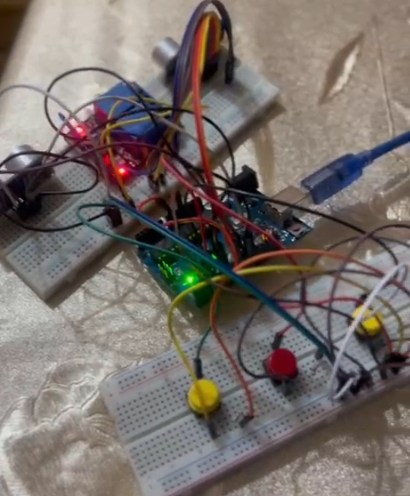
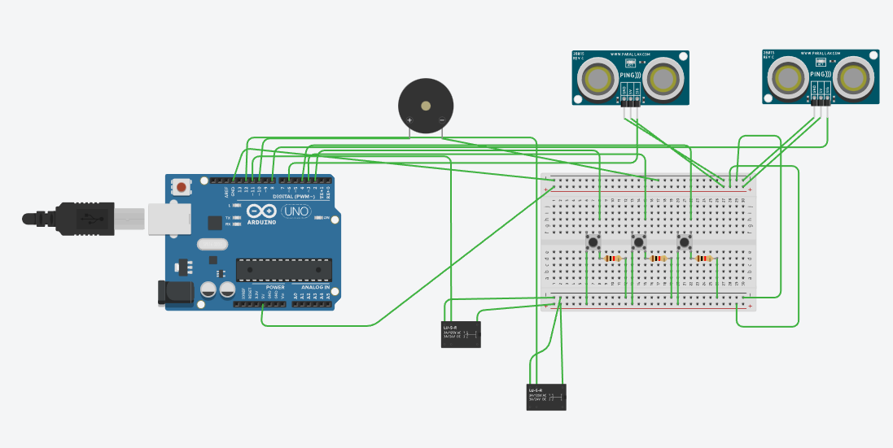
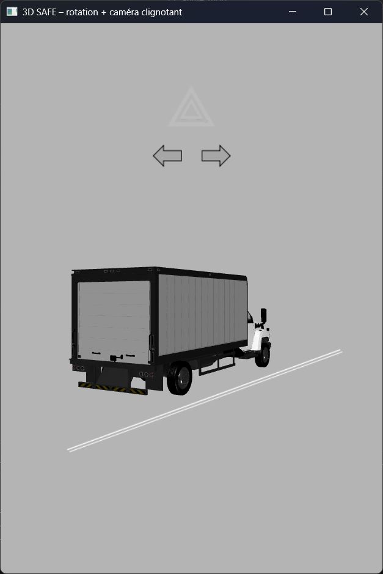
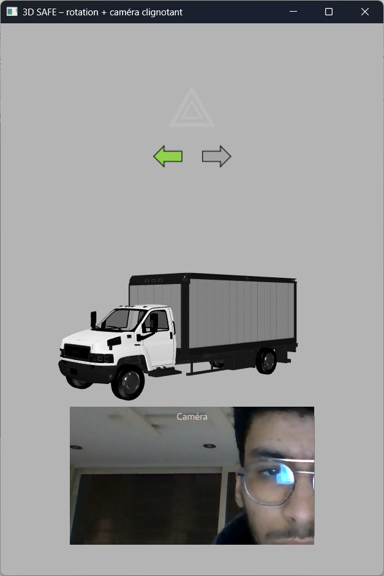
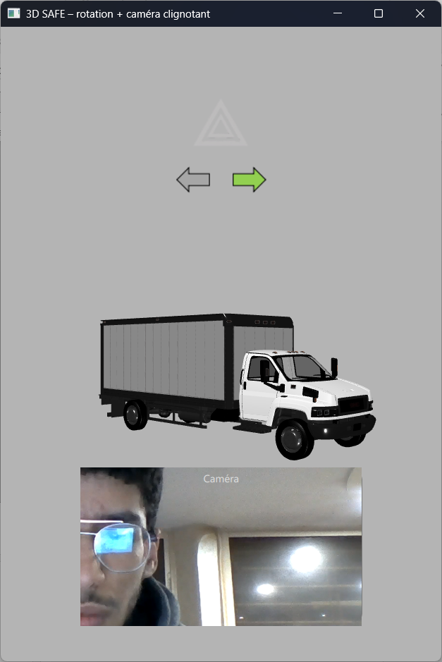
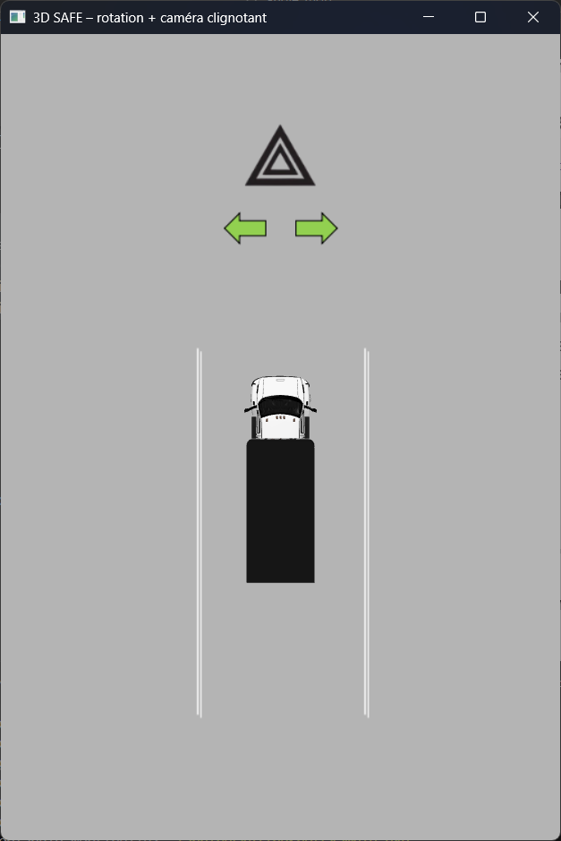

# 🚛 Truck Blind Spot Detection System (ADAS)

Un système avancé d'assistance à la conduite (ADAS) qui détecte les angles morts d'un camion en temps réel et alerte le conducteur via une interface Qt 3D interactive.

## 🎯 Caractéristiques principales

✅ **Détection d'obstacles** : Capteurs ultrasoniques gauche/droite pour scanner les angles morts  
✅ **Alertes intelligentes** : Système de buzzer + relais pour activer des voyants d'avertissement  
✅ **Interface graphique** : Application Qt 6 avec visualisation 3D en temps réel  
✅ **Contrôle Arduino** : Communication série avec microcontrôleur pour les capteurs et actionneurs  
✅ **Mode sécurité** : Système désactivable par bouton poussoir pour les interventions de maintenance  

## 🔧 Architecture

```
┌─────────────────────────────────────────┐
│   Application Qt 6 (main.qml)           │
│   - Interface utilisateur 3D            │
│   - Visualisation des angles morts      │
│   - Affichage des alertes               │
└────────────┬────────────────────────────┘
             │ Qt SerialPort
             ↓
┌─────────────────────────────────────────┐
│   ArduinoController (C++/QML)           │
│   - Gestion communication série         │
│   - Signaux d'alerte (dangerLeft, etc)  │
│   - Lecture boutons Arduino             │
└────────────┬────────────────────────────┘
             │ Serial (USB)
             ↓
┌─────────────────────────────────────────┐
│   Arduino Microcontrôleur               │
│   - Ultrasoniques (gauche/droite)       │
│   - Boutons poussoirs (BTN 1/2/3)       │
│   - Buzzer + Relais de commande         │
└─────────────────────────────────────────┘
```

## 📋 Prérequis

### Matériel
- **Microcontrôleur** : Arduino Uno/Mega ou compatible
- **Capteurs** : 2x HC-SR04 (ultrasoniques)
- **Actionneurs** : 1x Buzzer, 2x Relais 5V
- **Boutons** : 3x Boutons poussoirs
- **Port série** : USB vers Serial

### Logiciel
- **Qt 6** (Quick, Quick3D, SerialPort, Multimedia)
- **CMake** 3.21+
- **C++17** ou supérieur
- **Arduino IDE** (pour programmer le microcontrôleur)

## 🚀 Installation

### 1️⃣ Cloner/Télécharger le projet
```bash
cd /path/to/angle_mort
```

### 2️⃣ Programmer l'Arduino
1. Ouvrir `arduinopart/arduinopart.ino` dans l'Arduino IDE
2. Sélectionner le type de carte (Arduino Uno, Mega, etc.)
3. Charger le sketch sur le microcontrôleur
4. Vérifier les connexions PIN dans le sketch si nécessaire

### 3️⃣ Compiler l'application Qt
```bash
mkdir build
cd build
cmake ..
cmake --build .
```

### 4️⃣ Lancer l'application
```bash
./appTruckBlindSpotExample
```

---

## 🍓 Installation sur Raspberry Pi

### Avantages du Raspberry Pi
- Encombrement réduit (parfait pour un camion)
- Consommation énergétique minimale
- Suffisant pour cette application ADAS
- Connectivité réseau intégrée

### 📦 Installation de Qt 6.9.3 et dépendances

#### 1️⃣ Mettre à jour le système
```bash
sudo apt update
sudo apt upgrade -y
```

#### 2️⃣ Installer les dépendances système
```bash
sudo apt install -y \
  build-essential \
  cmake \
  git \
  libgl1-mesa-dev \
  libxkbcommon-dev \
  libxkbcommon-x11-dev \
  libx11-dev \
  libxext-dev \
  libxfixes-dev \
  libxi-dev \
  libxrandr-dev \
  libxrender-dev \
  libxinerama-dev \
  libxi6 \
  libxext6 \
  libxkbcommon0 \
  libglib2.0-0 \
  libharfbuzz0b \
  libfreetype6 \
  libpng16-16 \
  libjpeg62-turbo \
  zlib1g \
  libzstd1 \
  libssl3 \
  libdouble-conversion3 \
  libpcre2-16-0 \
  libgstreamer1.0-0 \
  libgstreamer-plugins-base1.0-0 \
  gstreamer1.0-plugins-base \
  gstreamer1.0-plugins-good \
  gstreamer1.0-plugins-bad \
  gstreamer1.0-alsa \
  libpulse0 \
  libudev1 \
  libdrm2 \
  libgbm1 \
  libxcb-xinerama0 \
  libxcb-icccm4 \
  libxcb-image0 \
  libxcb-keysyms1 \
  libxcb-randr0 \
  libxcb-render-util0 \
  libxcb-shape0 \
  libxcb-sync1 \
  libxcb-util1 \
  libxcb-xkb1 \
  libxkb1
```

#### 3️⃣ Télécharger Qt 6.9.3
```bash
# Option A : Depuis le dépôt officiel (recommandé)
# Ajouter le PPA Qt officiel
sudo apt install -y software-properties-common
sudo add-apt-repository ppa:beineri/opt-qt-6.9.3-focal
sudo apt update
sudo apt install -y qt69-meta-full

# Configurer l'environnement
export PATH=/opt/qt69/bin:$PATH
export LD_LIBRARY_PATH=/opt/qt69/lib:$LD_LIBRARY_PATH
```

**OU**

```bash
# Option B : Compiler depuis les sources (plus long, ~2-3h)
# https://wiki.qt.io/Building_Qt_6_from_Git
```

#### 4️⃣ Vérifier l'installation Qt
```bash
qmake --version
cmake --version
```

### 🔨 Compiler sur Raspberry Pi

#### 1️⃣ Cloner le projet
```bash
cd ~
git clone <votre-repo> TruckBlindSpotVisualizer
cd TruckBlindSpotVisualizer
```

#### 2️⃣ Créer et configurer le répertoire de compilation
```bash
mkdir -p build
cd build
```

#### 3️⃣ Configurer le projet avec CMake
```bash
cmake .. \
  -DCMAKE_PREFIX_PATH=/opt/qt69 \
  -DCMAKE_BUILD_TYPE=Release
```

#### 4️⃣ Compiler le projet
```bash
make -j$(nproc)
```

> 💡 `$(nproc)` utilise tous les cœurs disponibles pour accélérer la compilation

### ▶️ Lancer l'application sur Raspberry Pi

```bash
cd ~/TruckBlindSpotVisualizer/build

# Lancer avec GStreamer pour le rendu 3D optimisé
QT_MEDIA_BACKEND=gstreamer QT_QPA_PLATFORM=xcb ./appTruckBlindSpotExample
```

#### Variables d'environnement expliquées
| Variable | Valeur | Raison |
|----------|--------|--------|
| `QT_MEDIA_BACKEND` | `gstreamer` | Utilise GStreamer pour l'audio/vidéo (plus stable sur RPi) |
| `QT_QPA_PLATFORM` | `xcb` | Utilise le serveur X11 pour le rendu graphique |
| `LD_LIBRARY_PATH` | `/opt/qt69/lib` | (Si Qt en /opt) Localise les bibliothèques Qt |

#### Options de lancement avancées
```bash
# Avec logs détaillés (débogage)
QT_MEDIA_BACKEND=gstreamer QT_QPA_PLATFORM=xcb QT_DEBUG_PLUGINS=1 \
  ./appTruckBlindSpotExample 2>&1 | tee app.log

# Mode plein écran (recommandé pour un véhicule)
QT_MEDIA_BACKEND=gstreamer QT_QPA_PLATFORM=xcb \
  ./appTruckBlindSpotExample --fullscreen

# Avec rotation d'écran (si écran vertical)
QT_MEDIA_BACKEND=gstreamer QT_QPA_PLATFORM=xcb \
  QT_QPA_EGLFS_ROTATION=90 ./appTruckBlindSpotExample
```

### 🚀 Automatiser le démarrage au boot (optionnel)

Créer un service systemd pour lancer l'app au démarrage :

```bash
sudo nano /etc/systemd/system/truck-adas.service
```

Ajouter :
```ini
[Unit]
Description=Truck Blind Spot ADAS
After=network.target

[Service]
Type=simple
User=pi
WorkingDirectory=/home/pi/TruckBlindSpotVisualizer/build
Environment="QT_MEDIA_BACKEND=gstreamer"
Environment="QT_QPA_PLATFORM=xcb"
ExecStart=/home/pi/TruckBlindSpotVisualizer/build/appTruckBlindSpotExample
Restart=on-failure
RestartSec=5

[Install]
WantedBy=multi-user.target
```

Activer le service :
```bash
sudo systemctl daemon-reload
sudo systemctl enable truck-adas.service
sudo systemctl start truck-adas.service
```

Vérifier le statut :
```bash
sudo systemctl status truck-adas.service
```

### 📊 Performances Raspberry Pi

| Modèle | Processeur | RAM | Recommandation |
|--------|-----------|-----|-----------------|
| RPi 4B (2GB) | Cortex-A72 (1.5GHz) | 2GB | Minimum acceptable |
| RPi 4B (4GB+) | Cortex-A72 (1.5GHz) | 4GB+ | **Recommandé** ⭐ |
| RPi 5 | Cortex-A76 (2.4GHz) | 4GB+ | Idéal pour une meilleure réactivité |

> 💡 Avec RPi 4B 4GB, l'application tourne fluide à 30 FPS

### 🐛 Dépannage Raspberry Pi

| Problème | Solution |
|----------|----------|
| Erreur "qt.qpa.screen" | Installer `libxkbcommon-x11-dev` et redémarrer |
| L'appli crash au démarrage | Augmenter la mémoire GPU : `raspi-config` → Advanced → GPU Memory → 256MB |
| Pas de son/vidéo | Vérifier GStreamer : `gst-inspect-1.0` |
| Port série non détecté | Ajouter l'utilisateur au groupe dialout : `sudo usermod -a -G dialout $USER` (puis redémarrer) |
| Application lente | Passer en `QT_QPA_PLATFORM=eglfs` pour un meilleur rendu (moins compatible) |

### 🔌 Connexions Raspberry Pi



Pour connecter l'Arduino au Raspberry Pi :
```bash
# Vérifier la détection du port série
ls -la /dev/ttyUSB*
ls -la /dev/ttyACM*

# Vérifier les permissions
sudo usermod -a -G dialout pi
```

## 🔌 Câblage Arduino



| Composant | PIN Arduino | PIN Composant |
|-----------|-------------|---------------|
| Bouton 1  | D2          | GND           |
| Bouton 2  | D3          | GND           |
| Bouton 3  | D4          | GND           |
| Ultrason Gauche - TRIG | D6  | -      |
| Ultrason Gauche - ECHO | D7  | -      |
| Ultrason Droit - TRIG  | D8  | -      |
| Ultrason Droit - ECHO  | D9  | -      |
| Buzzer    | D10         | GND           |
| Relais Gauche | D11     | GND           |
| Relais Droit  | D12     | GND           |

## ⚙️ Configuration

### Paramètres de détection (`arduinopart.ino`)
```cpp
const int MAX_DETECT_CM = 10;    // Distance maximale d'alerte (cm)
const int CRITICAL_CM = 5;       // Distance critique (alerte haute)
const unsigned long LOOP_MS = 80; // Fréquence de balayage (ms)
```

### Port série (à adapter selon votre système)
La détection automatique du port COM/ttyUSB devrait fonctionner, sinon modifier dans `ArduinoController.cpp`.

## 📱 Fonctionnalités de l'application Qt



- **Visualisation 3D** : Camion avec zones de détection
- **Indicateurs de distance** : Barres de progression pour chaque côté
- **Alertes sonores** : Buzzer Arduino déclenché automatiquement
- **Contrôle des boutons** : Interaction directe avec l'Arduino via 3 boutons
- **Mode sécurité** : BTN3 active/désactive le système d'alerte

### Alertes du système







## 🎮 Utilisation

1. **Démarrer** l'application
2. **Vérifier** la connexion Arduino (vérifier les logs)
3. **Observer** les distances détectées en temps réel
4. **Écouter** les alertes sonores quand un obstacle est proche
5. **Appuyer sur BTN3** pour basculer le mode sécurité

## 🐛 Dépannage

| Problème | Solution |
|----------|----------|
| Arduino non détecté | Vérifier le port USB, adapter le COM/ttyUSB |
| Pas de détection | Tester les capteurs ultrasoniques à la main |
| Buzzer ne sonne pas | Vérifier l'alimentation 5V et le relais |
| Interface figée | Vérifier les logs pour erreurs de sérialisation |

## 📁 Structure du projet

```
angle_mort/
├── ArduinoController.cpp/h    # Classe de contrôle Arduino
├── main.cpp                   # Point d'entrée Qt
├── main.qml                   # Interface utilisateur (Qt Quick)
├── qml.qrc                    # Ressources QML
├── CMakeLists.txt            # Configuration de compilation
└── arduinopart/
    └── arduinopart.ino       # Code du microcontrôleur
```

## 🔐 Sécurité

⚠️ **Important** :
- Le système démarre en mode **SAFE** (désactivé)
- Utiliser **BTN3** pour l'activer
- Tester complètement avant utilisation en production
- Garder des systèmes d'alerte redondants en véhicule réel

## 📝 Notes de développement

- Framework : Qt 6 + CMake
- Langage : C++ 17 + QML
- Communication : Série 115200 baud
- Latence typique : ~80-100ms

## 🤝 Contribution

Les améliorations sont bienvenues ! N'hésitez pas à proposer des modifications pour :
- Optimiser la détection
- Améliorer l'interface
- Ajouter des capteurs supplémentaires
- Supporter d'autres microcontrôleurs

## 📸 Ajout d'images

Si vous souhaitez ajouter des images au README, vous pouvez :

1. **Créer un dossier** `assets/` ou `docs/images/`
2. **Ajouter vos images** (schéma électrique, photos du montage, screenshots)
3. **Les référencer** dans le README :
   ```markdown
   
   ```


## 📄 Licence

Ce projet est sous licence **MIT**. 
Voir [LICENSE](LICENSE) pour les détails complets.

### ✅ **Pour implémenter une licence :**

1. **Créer un fichier `LICENSE`** à la racine du projet :
   ```bash
   # Pour MIT
   curl -s https://opensource.org/licenses/MIT > LICENSE
   
   # Ou créer le fichier manuellement avec le contenu choisi
   ```

2. **Mettre à jour le README** en remplaçant le placeholder :
   ```markdown
   ## 📄 Licence
   
   Ce projet est sous licence **MIT**. Voir [LICENSE](LICENSE) pour plus de détails.
   ```

3. **Ajouter une entête aux fichiers principaux** (optionnel mais recommandé) :
   ```cpp
   // ArduinoController.cpp
   /*
    * Truck Blind Spot Detection System (ADAS)
    * Copyright (c) 2026 [Votre Nom]
    * Licensed under MIT License - See LICENSE file
    */
   ```

---

**Développé avec ❤️ pour améliorer la sécurité des conducteurs**
